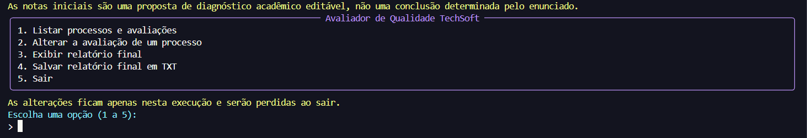
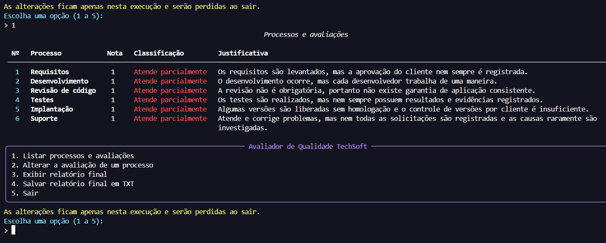
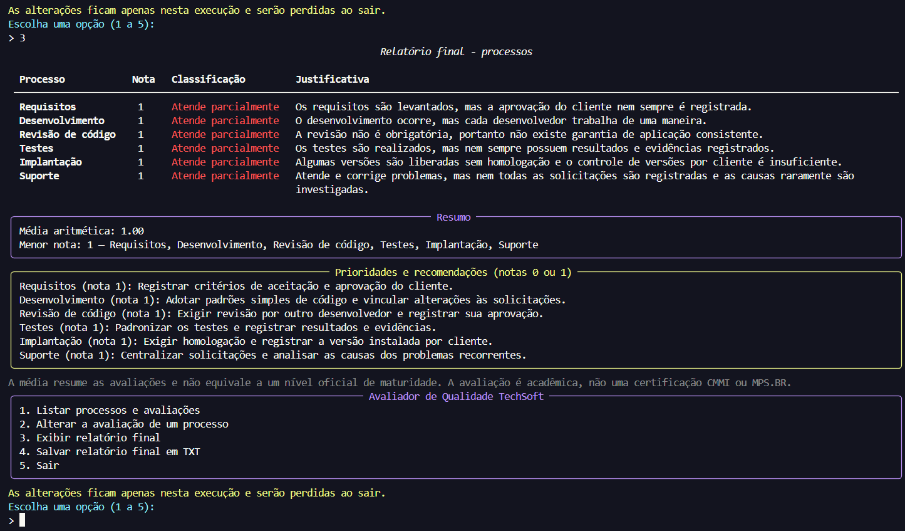

# Avaliador de Qualidade TechSoft

Programa acadêmico em Python para a disciplina de Qualidade de Software. Ele
avalia seis processos de uma empresa fictícia, a TechSoft, que enfrenta
dificuldades em atividades como registrar aprovações, padronizar o
desenvolvimento e documentar testes.

As avaliações são uma proposta acadêmica editável, não uma certificação nem um
nível oficial de maturidade CMMI ou MPS.BR.

## Funcionalidades

No menu, é possível listar os processos, alterar uma nota e sua justificativa,
exibir o relatório, exportá-lo em TXT ou sair do programa.

São avaliados requisitos, desenvolvimento, revisão de código, testes,
implantação e suporte. A escala de avaliação é:

| Nota | Classificação |
|---:|---|
| 0 | Não atende |
| 1 | Atende parcialmente |
| 2 | Atende em grande parte |
| 3 | Atende completamente |

O relatório calcula a média simples, mostra a menor nota e todos os processos
empatados nela. Notas 0 e 1 identificam processos prioritários; eles são
ordenados pela nota e recebem recomendações específicas. A média resume as
avaliações e não corresponde a um nível oficial de maturidade.

As alterações ficam na memória durante a execução e são perdidas ao fechar o
programa. A opção de exportação salva o relatório como TXT em UTF-8 na pasta
`relatorios/`, ao lado dos arquivos do programa.

## Tecnologias e arquivos

O projeto usa Python 3 e Rich. As versões das dependências estão registradas em
`requirements.txt`. A versão de Python validada é **3.12.10**.

| Arquivo | Responsabilidade |
|---|---|
| `avaliador_techsoft.py` | Menu, execução e gravação do arquivo TXT. |
| `processos.py` | Dados iniciais, classificações, validações e alterações. |
| `relatorio.py` | Cálculos e geração do conteúdo do relatório. |
| `interface.py` | Apresentação no terminal e interação com o usuário. |
| `requirements.txt` | Dependências e versões instaladas. |

## Instalação e execução no Windows PowerShell

Abra o PowerShell na pasta do projeto e execute:

```powershell
python -m venv .venv
.\.venv\Scripts\python.exe -m pip install -r requirements.txt
.\.venv\Scripts\python.exe avaliador_techsoft.py
```

Não é necessário ativar o ambiente virtual: os comandos chamam diretamente o
Python da `.venv`.

## Exemplo de uso

1. Escolha **1** para listar as avaliações.
2. Escolha **2** para alterar a nota e a justificativa de um processo.
3. Escolha **3** para exibir o relatório atualizado.
4. Escolha **4** para salvar o TXT.

As notas iniciais são uma proposta baseada no cenário, não uma conclusão
determinada pelo enunciado. Inicialmente, os seis processos têm nota 1: a média
é **1,00**, todos são prioritários e empatam na menor nota.

## Capturas de execução



*Menu principal com as opções disponíveis.*



*Processos com notas, classificações e justificativas.*




## Resumo para o relatório acadêmico

O programa organiza as avaliações informadas pelo usuário e automatiza os
cálculos: média, menor nota, empates e ordenação dos processos prioritários.
Também apresenta recomendações para esses processos e permite consultar o
resultado no terminal ou exportá-lo em TXT.

As notas e justificativas são decisões de quem realiza a avaliação. O programa
não coleta dados reais da TechSoft nem calcula indicadores de gestão; ele
processa as informações fornecidas e apresenta os resultados conforme suas
regras.
